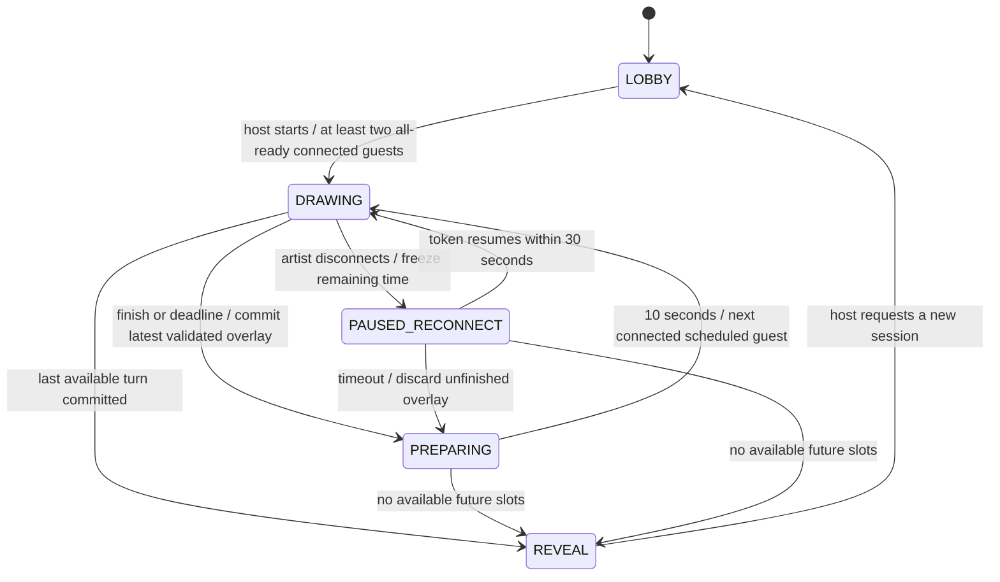

# Healing Strokes

A private, noncompetitive drawing ritual for 2–5 guests. Take timed turns on a shared canvas, rest with optional breathing guidance between turns, then discover and download the finished artwork together.

## Quick start

Requires **Node.js 22.12+** (Node 24 LTS recommended) and npm. From this directory:

```sh
npm ci
npm run dev
```

Open http://localhost:3000. Create a room, copy its invite, and open the invite in **another browser or an incognito context**. Different tabs in the same browser share the reconnect token and intentionally take over the same seat. Both guests read the visible seven-step How to Play card and mark ready. The host can choose 1–3 rounds and 2, 3, 4, or 5 minutes, then begin. The default is 1 round / 4 minutes.

Only the artist gets artwork. The waiting guest gets a breathing guide, metadata, and optional synthesized ambient sound (off by default). Use **Finish early** in both contexts for a quick demo; handoffs take exactly 10 seconds. Refresh the artist’s page to demonstrate restoring their seat, turn, remaining time, and last private checkpoint. At the reveal, either guest can download the actual 1200 × 800 PNG. The host can start a clean new session.

```sh
npm run lint
npm run typecheck
npm test
npm run build
APP_ORIGIN=http://localhost:3000 npm start
```

`npm test` includes real local WebSocket integration servers, so the environment must allow loopback socket binding. Browser tests:

```sh
npx playwright install chromium
npm run test:e2e
# Validate the compiled custom server as well (build first):
npm run build
npm run test:e2e:production
```

Playwright starts the app automatically unless a local development server is already running. The two-context scenario covers joining, rules collapse/reopen, readiness/settings, private drawing, undo/redo, audio opt-in, reduced motion, refresh, handoff, preserved earlier ink after erasing, reveal, and PNG signature/dimensions. A second scenario checks mobile rules, readiness, and overflow. Production browser tests start the compiled custom server on port 3001. State-machine tests use a fake clock; integration tests use actual independent Socket.IO clients to verify that spectators and another room never receive checkpoints or interim artwork. Test-only accelerated preparation in integration tests changes server memory directly; it is not exposed to clients.

## Architecture and source map

- `server.ts`: one long-lived HTTP server for Next.js App Router and Socket.IO.
- `src/server/game.ts`: synchronous, serialized room state machine, cryptographic guest identity, canonical overlays, authorization, scheduling decisions and TTLs.
- `src/server/repository.ts`: repository interface and in-memory implementation; no database needed.
- `src/server/socket.ts`: typed acknowledged events, Zod validation, transport origin checks, rate limits, metadata broadcasts and explicitly addressed authorized snapshots.
- `src/lib/shared/`: separate public metadata and authorized artwork DTOs, constrained drawing schemas, brand name and 36 curated prompts.
- `src/lib/client.ts`: reconnect identity, clock offset, connection/error state and acknowledged requests.
- `src/components/`: lobby/session UI, visible rules, Konva editor/reveal, breathing/audio controls, focus-managed dialogs.
- `src/app/`: landing page, room routes and responsive warm pastel styling.
- `tests/`: state-machine, WebSocket privacy/reconnection, and browser regression tests.

### State machine



A central 250ms scheduler checks server deadlines. Clients derive countdowns from server timestamps and a refreshed clock offset; they cannot advance phases. Each new turn has a unique UUID. Checkpoint sequence numbers must increase, and writes are checked against the current role, phase, turn ID, and server deadline. Public revisions increase only for metadata changes; private checkpoint writes return an acknowledgement without broadcasting artwork or a revision update.

The server selects a random prompt in the lobby, where the host may regenerate it. Starting retains that shared preview so the chosen prompt remains consistent. Connected guests are shuffled once; their order repeats each round. Disconnected waiting seats are skipped, new seats close after start, and reconnecting guests retain their exact identity. Duplicate connections use latest-connection-wins, revoke the old socket, and reject its later operations. A disconnected lobby host transfers immediately to the first connected guest; during play the host seat is retained for reconnection.

### Why Konva, and how artwork stays locked

Konva provides touch/pen/mouse pointer handling, scene layers, paths/shapes, viewport scaling and full-resolution PNG export without a native server canvas dependency. React-Konva renders a **1200 × 800** logical artboard. Supported objects are brush, eraser, line, rectangle and ellipse. The current-turn overlay supports color, 1–64px widths, undo/redo, and confirmed clear. Selection/move is intentionally omitted from this MVP; native shapes and simple tools keep touch behavior predictable.

The server stores a constrained canonical `Mark[]` per contribution, not arbitrary Konva JSON, SVG, URLs or uploaded images. Zod allows only explicit object properties/types, finite bounded coordinates and six-digit hex colors. Each committed overlay is rendered in its own locked layer. `destination-out` erasing affects only the artist’s current overlay, never earlier layers. The same representation and renderer are used for editing, reveal and export.

Canonical compositing happens **in authorized browsers**, not on the server. This avoids native graphics dependencies but means raster antialiasing may vary slightly between browsers. Snapshots are validated structured drawings, not server-rendered PNGs. Brush samples use a small distance threshold; brush pressure and selection/move are not supported.

### Surprise privacy

Waiting clients get only `PublicRoomState`: names, readiness/connections, turn order, phase, shared prompt, settings, timestamps and revision. There are no images, marks, tokens or checkpoint payloads in it. `CanvasState` is emitted directly to the current authenticated artist **only in DRAWING**, or to authenticated room members in REVEAL. PREPARING and PAUSED_RECONNECT do not deliver artwork. Every sensitive socket operation verifies the socket’s current seat, room and role. There are no artwork REST/file routes or enumerable snapshot endpoints. A request that includes a forged room field is rejected by strict schemas.

Guest tokens contain 32 cryptographically random bytes; only their SHA-256 digests live in server memory. Tokens are scoped to player and room, acknowledged only to their own connection, and stored in localStorage for refresh recovery. They are never put in invites, public payloads or logs. Display names are rendered as escaped text. Browser storage must be available for automatic refresh recovery. An authorized artist can of course remember/save artwork they have already seen; the server prevents disclosure of future contributions.

This is **application-layer surprise privacy, not end-to-end encryption**. The server holds drawings. It is not an account-based identity system, and invite links may be shared by anyone who has them. Use HTTPS in production and trusted code on the origin because browser token storage is susceptible to same-origin script compromise.

### Saving and failure behavior

Private checkpoints save every 3 seconds while connected, with visible save/error status. Finish early submits the latest full overlay. On normal deadline expiration, the server commits the last accepted checkpoint; up to roughly 3 seconds of unsaved marks can be lost. Checkpoints are not streamed to anyone else. If the artist disconnects, the clock pauses for up to 30 seconds; token reconnection restores the latest checkpoint and remaining time. If the grace expires, the entire unfinished overlay is discarded, clearly disclosed by the waiting UI. An acknowledgement timeout asks the user to reconnect rather than claiming a successful save. Nothing is stored in a personal gallery.

### Bounds and in-memory tradeoffs

One process, **one replica only**. Rooms and artwork disappear on restart. No multi-instance scalability is claimed. Repository storage can be replaced later, but distributed timers, atomic transitions and Socket.IO coordination would also need designing.

- Five seats maximum, 100 rooms maximum, 750 concurrent sockets total and 25 per peer address.
- Eight-character cryptographically random room codes from a 32-character human-friendly alphabet.
- 40 create/join/resume attempts per remote address per minute; 100 messages per socket per 10 seconds; checkpoints no faster than every 800ms.
- Incoming transport cap 512KB, drawing-write cap 480KB, maximum 400 objects / 40,000 coordinates per overlay, maximum 4,000 coordinates per path. Shapes have exactly two points.
- Maximum 200,000 coordinates per room and 2,000,000 across the repository. Detail-cap errors ask the artist to simplify their current turn.
- Empty rooms expire after 30 minutes, inactive lobbies after 2 hours, reveals after 60 minutes. Cleanup checks every 250ms.
- These are lightweight MVP defenses, not a substitute for production ingress/DDoS limits. IP limiters use the actual peer address; they do not trust forwarded headers. Behind a reverse proxy, the limit may be shared by guests using that proxy.

## Environment and deployment

See `.env.example`. Development defaults to port 3000 on `0.0.0.0`. Next loads standard environment files; configure host environment variables explicitly for production.

| Variable     | Purpose                                                                                                                                  |
| ------------ | ---------------------------------------------------------------------------------------------------------------------------------------- |
| `PORT`       | HTTP/WebSocket port; hosts normally supply it.                                                                                           |
| `HOSTNAME`   | Bind address, normally `0.0.0.0`.                                                                                                        |
| `APP_ORIGIN` | Exact public scheme/host/port, no trailing slash; **required in production**. Used to reject cross-origin browser transport connections. |
| `NODE_ENV`   | `production` is set by `npm start`.                                                                                                      |

Deploy to a WebSocket-capable Node service on Render, Railway, Fly.io or an equivalent host:

1. Set the service root to this `stillcanvas` directory and use Node 24 LTS.
2. Build command: `npm ci && npm run build` (install development dependencies at build time).
3. Start command: `npm start`.
4. Set `APP_ORIGIN` to the exact HTTPS service URL and `HOSTNAME=0.0.0.0`; let the host supply `PORT`.
5. Enable WebSocket upgrades, HTTPS, and appropriate reverse-proxy timeouts. Use exactly **one running instance** and disable autoscaling to multiple replicas.
6. Health checks can use `GET /`. Deployments/restarts intentionally reset all rooms; schedule them with that behavior in mind.

The production build compiles Next and bundles the custom Node server to `build/server.cjs`; start from the project directory so Next can find `.next`. This traditional Socket.IO server must **not** be deployed as a stateless serverless function, and Next’s standalone output is not used. Sites/Cloudflare Workers hosting was deliberately not used because the brief explicitly requires a long-lived Node Socket.IO service. No hosted deployment was created.

## Accessibility, assets, and manual QA

Locally generated desktop and mobile review screenshots are in `docs/screenshots/`.

Semantic labels, keyboard-visible focus, focus-trapped/Escape-close dialogs, readably numbered rules, restrained status announcements, explicit connection/paused states, and a manual reduced-motion setting are included. System reduced-motion disables breathing animations. Breath guidance remains available as static text. Timers are not live regions and do not announce every second. Audio is off by default, synthesized locally using three quiet sine oscillators after opt-in, independently volume controlled, suspended when hidden, and cleaned up on exit. There are no audio licenses to attribute. The landing garden is an original inline SVG illustration; fonts use optional Google Fonts with system fallbacks.

Manual checks before an actual public launch:

- Use 2–5 independent contexts, confirm sixth-seat rejection and host-only settings.
- Inspect waiting-client network frames during checkpoints: metadata only; neither artwork nor token broadcasts.
- Disconnect artist below/above the 30-second grace, disconnect future artists, close all windows, and test restart recovery messaging.
- Draw mouse/pen/touch lines and shapes at desktop/tablet/phone widths; verify erasing/undo leaves earlier contributions intact and PNG dimensions remain fixed.
- Test screen-reader focus, keyboard-only rules/dialog/tools, timer announcements, reduced-motion preference and audio visibility changes across supported browsers.
- Safari, Firefox and physical stylus devices need manual device testing; automated browser coverage uses Chromium.

The brand can be renamed at `src/lib/shared/model.ts`; update the metadata, filename prefix and localStorage namespace if desired. No clinical claims, scores, chat, accounts, paid APIs, or galleries are included.

## Verification recorded October 14, 2026

- `npm install`: successful; final dependency audit reports **0 vulnerabilities**.
- `npm run lint` and `npm run typecheck`: successful.
- `npm test`: **19 tests passed**, including actual Socket.IO privacy/reconnection tests.
- `npm run build`: successful Next.js production output and bundled Node server.
- `npm run test:e2e`: **2 Chromium scenarios passed** (full two-context session and mobile lobby).
- `npm run test:e2e:production`: the same **2 scenarios passed** against `npm start` and the compiled custom server.
- Generated desktop/mobile screenshots were inspected locally. PNG export was checked for its file signature and exact 1200 × 800 dimensions; a later eraser contribution did not remove earlier ink.

This workspace's default Node was older, so verification used its available Node 24 runtime. Dependency downloads and local socket/browser tests needed execution outside the workspace sandbox. No feature remains mocked; physical device/Safari/Firefox checks and a hosted deployment have not been performed.

### Container deployment

A multi-stage `Dockerfile` is included for a single Node 24 container. It builds the Next.js app and custom Socket.IO server, installs only production dependencies in the runtime stage, and runs as an unprivileged user. Set `APP_ORIGIN` to the exact generated HTTPS website URL, keep `HOSTNAME=0.0.0.0`, and run one replica. The platform can override `PORT`.

The Docker image has not been built locally because Docker is unavailable in this workspace. A compatible hosting account must be connected before a hosted deployment and live-link verification can be completed.

### Render free-plan deployment

`render.yaml` explicitly selects a **free** Docker web service. Deploy the app directory as the repository root, set `APP_ORIGIN` to its exact generated HTTPS `onrender.com` URL, and use one instance. The free tier sleeps after 15 minutes without inbound HTTP/WebSocket traffic, and resuming can take about a minute. Sleeping or restarting clears in-memory rooms. Monthly usage limits apply, and hosting policies can change; this is not a lifetime-free guarantee. Do not upgrade to a paid plan unless explicitly requested.
